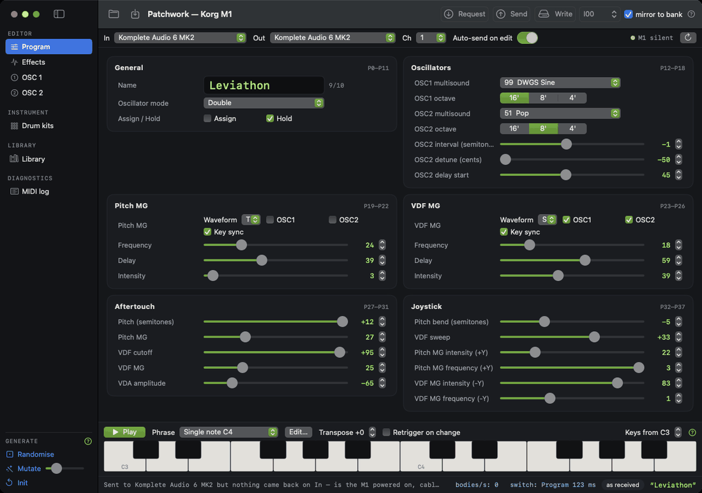
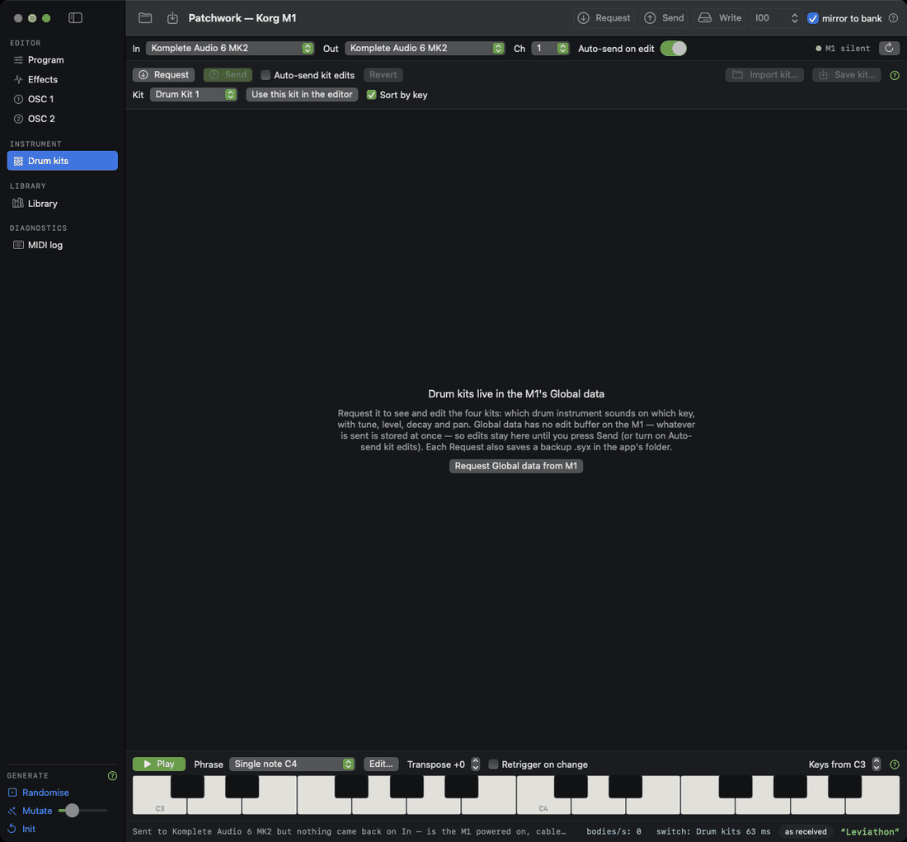
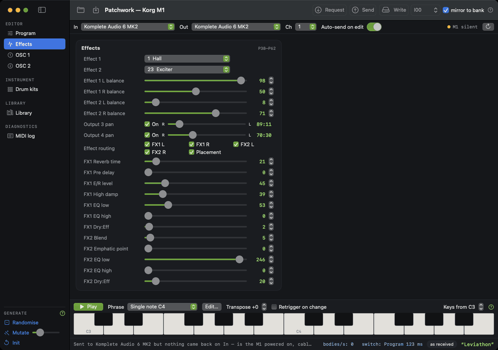
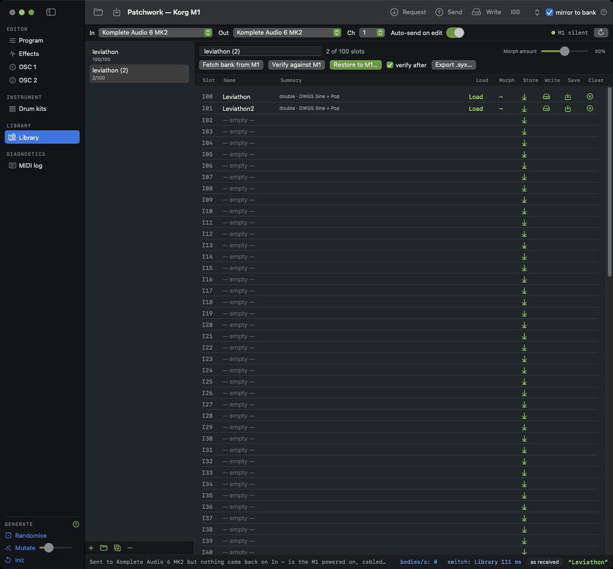
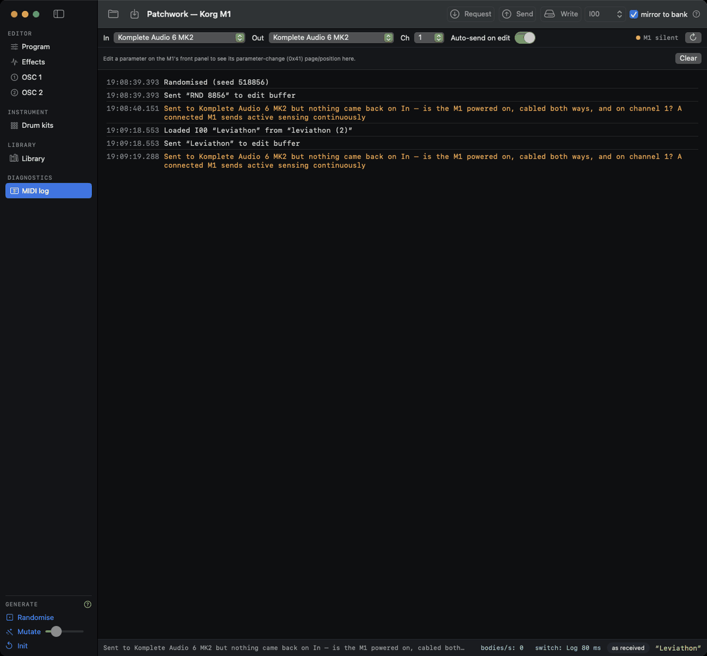

<p align="center">
  
</p>
<h1 align="center">Patchwork</h1>
<p align="center">
  A native Mac editor, librarian and audition tool for the <b>Korg M1</b> — with a command-line companion and a readable JSON patch format that Claude can write.<br>
  Built on one <code>SynthDefinition</code> protocol so that adding another synth is one file.
</p>
<p align="center">
  <a href="https://github.com/monstrous-media/patchwork/releases/latest"></a>
  <a href="https://github.com/monstrous-media/patchwork/actions/workflows/ci.yml"></a>
  
  <a href="LICENSE"></a>
</p>



## Download

Grab **Patchwork-x.y.z.zip** from the [latest release](https://github.com/monstrous-media/patchwork/releases/latest), unzip, and drag to Applications. The app is signed with a Developer ID and notarised, so it opens without warnings. The same page has `patchwork-cli-x.y.z-macos.tar.gz` for the command-line tool.

## What it does

- **Edit every parameter** of an M1 program — all 143 bytes, grouped as the panel groups them, each row with a tooltip and its SysEx byte range. Edits reach the M1's edit buffer about 80 ms after you stop moving a control.
- **Hear it as you go.** A play bar with editable test phrases, a two-octave keyboard, transpose, and *retrigger on change* so every edit, randomise or morph plays itself.
- **Generate.** Randomise (with playability rules), mutate N% of parameters, morph toward any stored program; changed rows glow so you can see what moved.
- **Banks and slots.** Fetch the M1's 100 programs into a local bank, write one slot or restore a whole bank, verify against the synth, import/export `.syx`, keep as many banks as you like — all undoable with ⌘Z.
- **Drum kits.** The four kits in the M1's Global data: which instrument on which key, with tune, level, decay and pan — and a backup `.syx` on every Request.
- **Know what the synth is doing.** A heartbeat in the MIDI bar (the M1's active sensing), acknowledgement of every send, and a colour-coded MIDI log that says *what to check* when nothing comes back.
- **JSON patches.** A documented, schema-validated format (`korg-m1-program/1`) plus a Claude skill, so "make me a warm pad for the M1" can end in a file you audition with `patchwork send`.
- A built-in guide (Help ▸ ⌘?) and dark / light / system appearance.

<table>
<tr>
<td width="50%"><br><sub><b>Oscillator pages</b> — VDF/VDA with live envelope sketches</sub></td>
<td width="50%"><br><sub><b>Effects</b> — two slots, routing, per-type parameters</sub></td>
</tr>
<tr>
<td width="50%"><br><sub><b>Library</b> — banks, slots, Fetch / Verify / Restore</sub></td>
<td width="50%"><br><sub><b>MIDI log</b> — acks green, incoming blue, warnings amber, refusals red</sub></td>
</tr>
</table>

## Wiring and M1 settings

- Interface **MIDI OUT → M1 MIDI IN**, and M1 **MIDI OUT → interface MIDI IN** (needed for Request / acks / the heartbeat). Use the socket marked OUT on the M1, not THRU.
- On the M1: **GLOBAL → 5 → Page+ → Exclusive = ENA**; the global channel must match the app's *Ch*.
- **GLOBAL → 6 → Memory Protect → Program = OFF** to Write or Restore.
- The app switches the M1 to Program mode itself before transfers.

Tested with a Komplete Audio 6 MK2; any class-compliant interface with DIN MIDI should do. Some USB interfaces drop the 16 KB all-program dump — the app's Fetch reads one program at a time instead.

## Build from source

macOS 13+ with Xcode or the Command Line Tools.

```sh
swift test                               # Core tests (also run on Linux in CI)
swift run PatchworkApp                   # the app, straight from the package
swift build -c release && .build/release/patchwork ports
tools/make-app.sh                        # assemble (and optionally sign + notarise) Patchwork.app
```

```
Sources/PatchworkCore   pure Swift: SynthDefinition protocol, generic codec/model/generators, the Korg M1 definition (unit-tested, Linux-clean)
Sources/PatchworkMIDI   CoreMIDI wrapper (endpoints, send, SysEx reassembly)
Sources/patchwork       CLI: ports · dump · bank · restore · send · write · play · global · random · mutate · morph · describe · params · mode · monitor
Sources/PatchworkApp    SwiftUI app: generated editor pages, play bar, banks & slots, drum kits, undo, theme, built-in guide
schema/ skills/         JSON schema + Claude skill for authoring patches
docs/                   user guide, generated parameter reference, screenshots
tools/                  Python reference codec (test vectors), make-app.sh, sync-docs.sh
```

## Command line

```sh
patchwork dump --json current.json           # grab what the M1 is playing now
patchwork send examples/glass-pad.json       # audition
patchwork play --phrase "Pad swell"
patchwork bank --syx factory.syx --json-dir bank/   # back up all 100 programs (do this before any Write!)
patchwork restore factory.syx --verify       # asks first; add --yes in scripts (otherwise a non-interactive run refuses)
patchwork global --syx global.syx            # drum kits and global settings
patchwork monitor --raw                      # watch every byte that arrives
```

## Three places a sound lives

**Edit buffer** (what the M1 plays now; temporary) · **slot** (I00–I99, stored in the M1; Write/Restore only) ·
**bank** (a local 100-slot copy; many of them). Verbs: Request, Send, Write, Fetch, Restore, Store, Load. The
in-app guide (Help menu, ⌘?) explains each, and every control has a tooltip.

## Patch JSON and Claude

`schema/m1-patch.schema.json` documents every field with its musical meaning; `skills/korg-m1-patch/SKILL.md`
teaches Claude the M1 signal path and a cookbook of edits; `patchwork validate / send / play` close the loop.

## Extending to other synths

Everything above the `SynthDefinition` protocol (`Sources/PatchworkCore/Synth.swift`) is synth-agnostic:
MIDI, transfers, banks, undo, the table-driven editor, generators, play bar, help. `KorgM1.swift` is the
reference implementation; the app selects the synth at compile time (`ActiveSynth`). See `CONTRIBUTING.md`.

## SysEx facts (Korg M1)

```
F0 42 3g 19 ff … F7     42 Korg · 3g channel g · 19 M1 family · ff function
10 → 40  program dump (143 params, 7-in-8 packed, 170 bytes)   1C 00 → 4C 00  all programs (16,350 bytes)
11 00 nn write to slot nn      12 → 42 mode data      4E mode change      0E 00 → 51 00 global data (861 bytes: settings + 4 drum kits)
23/24 load ok/error · 21/22 write ok/error · 26 format error · FE active sensing
```

## Known gaps

- Single-parameter (`41`) live edits: the editor re-sends the whole program (debounced). The MIDI log shows the
  page/position of panel edits, which is the map needed.
- Effect parameter byte encodings per effect type (shown raw).
- Combinations and sequencer data aren't modelled.
- Dual-effect names 26–33 follow the manual's listing order; verify on the panel.

## Licence

MIT, © monstrous-media — see `LICENSE`. Korg and M1 are trademarks of Korg Inc.; this project is not affiliated
with Korg. Don't commit factory banks or instrument dumps (they're Korg's copyright): `bank/`, `*.syx`,
`factory*.json` and `*-bank.json` are gitignored for that reason.
